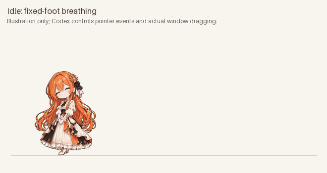

# Claude 娘 · 向日葵：Codex 原生桌宠

保留橙发、向日葵发饰和橙白黑裙装，让 Claude 娘在 Codex 里陪你工作。任务失败时会双手握拳、泪流满面大哭。


参考视频逐帧核对后，本版改为**固定脚底的立绘压缩、拉伸和回弹**，换表情时也有弹性反馈。拖动时保持同一站姿，不切换跑步腿部动作：



上图是素材动作示意，不是客户端录屏；真实窗口位置跟随你的拖动。九组动画预览按当前 Codex 的原生时长播放，待机一轮 6.6 秒，没有为了显得流畅而加速。

## 安装

在仓库根目录运行：

```sh
python3 codex/install.py
```

Windows 可使用 `python codex/install.py`。安装脚本仅使用 Python 标准库，无需 Pillow。

然后打开 Codex **设置 → Mini & Pets / Pets（桌宠）**：

1. 点 **Refresh / 刷新**，让应用重新读取本地素材。
2. 选择 **Claude 娘 · 向日葵**。
3. 点页面上的 **Show mini / Show pet（显示桌宠）** 打开悬浮窗。选中角色只是在选择外观，不代表窗口已经打开。
4. 想让它一直留在桌面上，将 **Visibility** 设为 **Always visible**。

也可以在 Mac 上按 **Option+Space** 打开浮动控件，或在应用输入框使用 `/pet`。以上显示入口见 [官方桌宠说明](https://learn.chatgpt.com/docs/pets)。

也可以手动把整个 `claude-sunflower` 文件夹复制到 `~/.codex/pets/`；设置了 `CODEX_HOME` 时复制到该目录下的 `pets/`。保留包内的 `pet.json` 和 `spritesheet.webp` 两个文件。

重复运行安装脚本会识别相同版本。如果目标目录已有不同内容，脚本会停止；使用 `--replace` 可先备份旧包到 `CODEX_HOME/pet-backups/` 再更新。安装过程不修改你的其他桌宠或应用偏好。

## 没有显示时

- **列表中没有角色**：点 Refresh。当前版本会缓存自定义角色列表，只重新打开设置页不会保证重新读取文件。
- **能选中角色，却没有悬浮窗**：点 Show mini / Show pet，或按 Option+Space。不要把选中外观当作启动窗口。
- **点击其他窗口后就消失**：检查 Visibility 是否设为 On demand；常驻使用 Always visible。
- **Mini 小窗出现，但人物没显示**：检查页面上人物显示选项，并确认选的是角色而不是只有控件的 Mini。
- **内置 Codex、Dewey 等角色也全部没有图像，但卡片文字正常**：先完全退出客户端后重新打开，检查内置图像是否恢复。这属于客户端共用显示环节的排查，重新安装单个 Claude 素材包不能确定解决。

## 原生互动

本素材包在 Codex 内提供固定循环的表情变化、悬停回应和拖动时的弹性站姿。**鼠标移到角色上方**会触发 `jumping` 行，现已设计为伸手回应；移开后恢复工作或待机状态。

当前客户端的**单击**固定为打开主窗口，右键只有 Settings / Close Mini，素材包不能把它改成点击轮换表情，也不能添加随机窗口游走。原生待机每帧会停留约 0.7–1.9 秒，无法只用静态图集达到参考视频约 30fps 的连续变形。具体核对见 [原生互动边界](interaction-contract.md)。

独立 [macOS 应用](../macos/README.md) 另有随机漫游功能；它与本次视频式固定脚底动效是两种效果。

## 动画状态

这是 Codex 原生 v1 素材包，9 个状态共 57 帧。无需额外窗口、Claude 插件钩子或后台服务。

| 状态 | 动作 | 帧数 |
|---|---|---:|
| idle | 微笑、眯眼笑、自信姿态的固定循环与轻微压伸 | 6 |
| running-right | 拖向右侧，保持站姿，脚底固定并弹性压伸 | 8 |
| running-left | 拖向左侧，与右侧同面向、同站姿 | 8 |
| waving | 伸手招呼、回弹 | 4 |
| jumping | 鼠标悬停时伸手回应，先拉长再压扁恢复 | 5 |
| failed | 大哭立绘的弹性变化 | 8 |
| waiting | 眯眼笑、轻微呼吸，等待你回复或确认 | 6 |
| running | 敲键盘立绘的轻微压伸 | 6 |
| review | 看笔记立绘的轻微呼吸 | 6 |

具体触发由 Codex 决定；`running` 表示工作。左右移动保留 Codex 要求的状态名称，人物面向和站姿保持一致，实际窗口位移由 Codex 控制。此包采用 v1 格式，没有 v2 的鼠标方向追视。

图集为透明 WebP，1536×1872，8 列×9 行，单格 192×208；各行未使用的格子全透明。状态表和帧时长见 [animation.json](animation.json)，`nativeDurationMs` 是当前客户端实际时长记录，不是可修改客户端速度的配置。原图、变形参数和参考视频量测见 [video-motion.json](video-motion.json)；来源见 [SOURCES.md](SOURCES.md)。

## 重新编译素材

需要 Python 3.10+ 和 Pillow。运行 `python3 codex/tools/build_video_style.py --output-dir /path/to/candidate` 可从仓库原始立绘重新生成图集、校验记录和原生速度预览。脚本只渲染现有立绘的几何变换，不修改原始 PNG。

## 原版 Claude 插件的大哭表情

`pet/sprites/crying.png` 可独立使用。整轮任务以 `reason: error` 结束时显示大哭；普通工具报错仍为惊慌，连续三次工具报错仍为石化。

Claude Windows 悬浮窗和 Codex 原生桌宠是两个独立入口；只用 Codex 时不用安装 Claude 插件。
