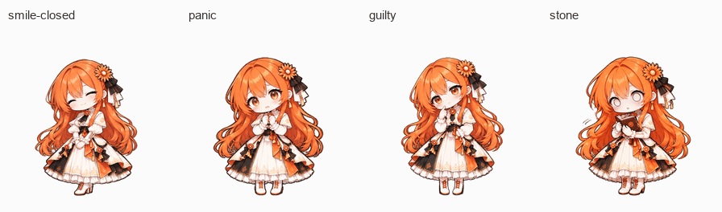

# macOS 独立桌宠

一个原生 Swift / AppKit 应用。双击 **Claude Desktop Pet.app**，Claude 娘就会以透明背景悬浮在桌面上；无需运行 Python、网页窗口或额外服务。


四种补充表情的实际帧序与播放节奏（眯眼笑、慌张、委屈、石化）：



支持 Apple Silicon 和 Intel Mac，macOS 12 或更新版本。安装后的应用不需要开发工具或第三方运行环境。

## 使用

- **单击角色**：从11种表情中随机换一种，避免与当前表情相同；展示约8秒后恢复自动模式，再次点击重新计时。每种表情内部仍按固定帧序和时长循环，保证动作连贯。连续点击不会打开主窗口。
- **鼠标移上去**：当前立绘先轻轻蓄力，再真正向上跳起、落地回弹，约0.8秒完成。停在上方只触发一次，移开后再次进入可以重触发；点击、拖动、菜单和暂停不会积压额外跳跃。
- **拖动角色**：按住后移动超过约4个屏幕点才开始拖动，小幅手抖仍按单击处理；真正拖动后不切表情，保留站姿并轻微回弹、呼吸。
- **右键角色 / 点击菜单栏太阳图标**：选择 11 种表情（原有十种，加上大哭）；调整大小、暂停动画、置顶、隐藏或退出。
- **自动跟随 Codex**：任务开始时工作，全部已观察到的任务完成后庆祝，再回到随机待机。Codex仍有任务运行时，保持工作表情属于正常行为。
- **自由待机（随机表情）**：右键选择后，即使Codex正在工作也继续随机换表情、缓慢漫游；可随时切回「自动跟随 Codex」，显示最新任务状态。模式会记住。
- **普通选表情与固定表情**：右键选表情也只展示约8秒，随后恢复原来的自动模式。只有明确勾选「固定当前表情」才一直保持；取消固定或重新开启「待机随机表情」会解除保持。
- **每种表情都有持续动作**：「Codex 鲜亮」的11种表情都播放逐帧动画，包括新增的眯眼笑、慌张、委屈、石化四组六帧画面；再叠加轻微身体动效与约0.8秒的切换回弹。手动固定表情也会持续播放。原立绘风格仍提供微笑轻摆、打字轻抖、撒花小跳等立绘变形。系统开启「减少动态效果」时关闭动作与逐帧播放。
- **待机时自己活动**：全部11种表情都会参与，包括微笑、眯眼笑、敲键盘、看笔记、招呼、庆祝、慌张、委屈、石化、自信和大哭。每轮随机打乱顺序，每种出现一次后再重新洗牌；跨轮也避免连续选中相同表情，拖动和调整大小不会丢掉尚未展示的表情。选择间隔约6–12秒，短暂展示后回到微笑；漫游过程中会适当顺延。也会围绕你放置的位置缓慢挪动，移动期间保持当前立绘。鼠标靠近只暂停走动，表情计时继续；移开后至少留2秒缓冲再移动。后台刷新变慢不会不断推迟随机切换，唤醒也不会瞬移或补播一串动作。右键可分别关闭「待机随机表情」与「自动漫游（可选）」。
- **显示风格**：默认「Codex 鲜亮」，原有七组表情保留早期 Codex 图集的鲜艳纹理与像素采样，另外四组采用同画风的新逐帧素材；11组都保留完整192×208格子直接绘制。右键「显示风格」可切回「原立绘 · 原色／明亮／更明亮」。切换风格保留当前表情和互动。
- **打开 Codex**：右键菜单选择「打开 Codex」。主鼠标操作专用于换表情和拖动。
- **安静显示**：默认隐藏状态气泡，可从右键菜单开启。暂停动画会冻结动作；按下但尚未拖动、或打开菜单时也暂时停住，便于操作。
- 透明像素可以点击穿透，不会用整个矩形挡住桌面；拖动不抢键盘焦点。
- 位置和大小会自动保存，多显示器或显示器变化时会将角色保持在可见区域内。

默认尺寸按 Codex 原生桌宠的 **112pt 格子宽度、192:208比例**绘制，人物可见高度约100pt。Codex图帧保留完整格子直接绘制，不会再次缩小人物；额外透明顶部余量用于跳跃。右键「角色大小 → 与 Codex 相同」可恢复此尺寸，也有小、大两档。原立绘风格仍从400px高的PNG平滑绘制。

漫游以拖放位置为中心，横向最多约110pt、纵向约30pt，遇到屏幕边缘缩小范围。移动不会把活动中心越带越远，也不会不断写入位置偏好。跟随模式下工作时，以及拖动、菜单展开、隐藏或暂停时停止待机活动；自由待机可在Codex工作时继续活动，鼠标靠近时仅暂停走动。移动采用缓入缓出路径，身体保留固定脚底的弹性与呼吸，不额外让整个窗口上下晃。待机中的敲键盘、慌张或大哭都是随机表情展示，不会改变真实任务状态。

「Codex 鲜亮」采用用户对比截图所示的早期生成图集，并补齐四种表情的同风格动画；这与后来换回的原始立绘是不同的素材版本，不能仅靠提亮gamma互相还原。原有七组像素保持不变，补充图集 `CodexExtraExpressions.png` 为1536×832、8列×4行，每行前6帧有效、后2格透明，行序为眯眼笑／慌张／委屈／石化。应用同时保留原立绘，并在30Hz绘制层叠加悬停跳跃与小幅动效。素材来源见 [来源记录](../codex/SOURCES.md)。

新增四组采用不同的循环节奏，并保留自然停顿：眯眼笑约2.18秒、慌张1.32秒、委屈2.70秒、石化3.42秒，避免所有表情都快速、连续眨眼。

## 从源码构建和安装

构建需要 Apple 的 Xcode Command Line Tools（`xcode-select --install`）。在仓库根目录运行：

```sh
./macos/install.sh
```

脚本会构建 Apple Silicon + Intel 通用应用，校验素材与活动监听逻辑，安装到 `~/Applications/Claude Desktop Pet.app` 并启动。单独构建使用：

```sh
./macos/build.sh
```

产物位于 `macos/build/Claude Desktop Pet.app`。`./macos/install.sh --no-open` 可只安装；`--destination DIRECTORY` 可选择应用目录。更新已安装的本应用时，请先从菜单退出；安装脚本会备份旧应用，不覆盖其他应用。

本地构建使用临时签名，没有 Apple Developer ID 公证；在本机从源码构建后运行即可。源码构建自测也可手动运行：

```sh
"macos/build/Claude Desktop Pet.app/Contents/MacOS/ClaudeDesktopPet" --self-test
```

## Codex 状态跟随的范围

监听采用只读方式，从本机 Codex 日志的新事件提取任务开始、结束与轮次标识。应用启动时跳过已有历史；重启后会等待新的任务证据。多个聊天同时工作时按活动任务集合聚合，子代理的复制历史不会重复计数。同一聊天的新一轮会替换旧一轮，迟到的旧结束或进度事件不会影响当前任务，避免旧轮次一直阻止待机。

索引和日志位于 `CODEX_HOME`，未设置时使用 `~/.codex`。只查询最近主聊天的日志路径等必要字段，不读取索引里的标题、消息预览或首条用户消息。桌宠不展示、保存或上传对话正文，也不修改 Codex 设置；无需录屏、辅助功能或 API 密钥。

这是对当前本地日志格式的兼容实现，不是 Codex 的稳定公开事件 API。日志格式或索引不可用时，桌宠仍可手动切换表情。普通命令错误、网络重试，以及没有成败字段的任务完成事件，不会被猜成整轮失败；大哭始终可从右键菜单选择，只有明确的终止失败事件才自动触发。长期没有事件时回到休息，不判定失败。

## 与其他入口的关系

这个 `.app` 独立于 [Codex 内置桌宠素材包](../codex/README.md)，可以直接在 macOS 桌面显示。原仓库的 Windows Claude 插件仍使用原有 Python 窗口。感谢 [wangmeng003 的 Mac 移植版](https://github.com/wangmeng003/claude-desk-pet-mac) 提供实现思路；本应用使用独立编写的 Swift 代码。

单击换表情、连续呼吸与弹性回应由本应用处理。Codex 内置素材包的点击动作和播放速度由客户端固定，不能仅靠 `pet.json` 修改。

若原先已打开 Codex 内置桌宠，可在 Codex 设置里关闭它，以免桌面同时出现两只。
